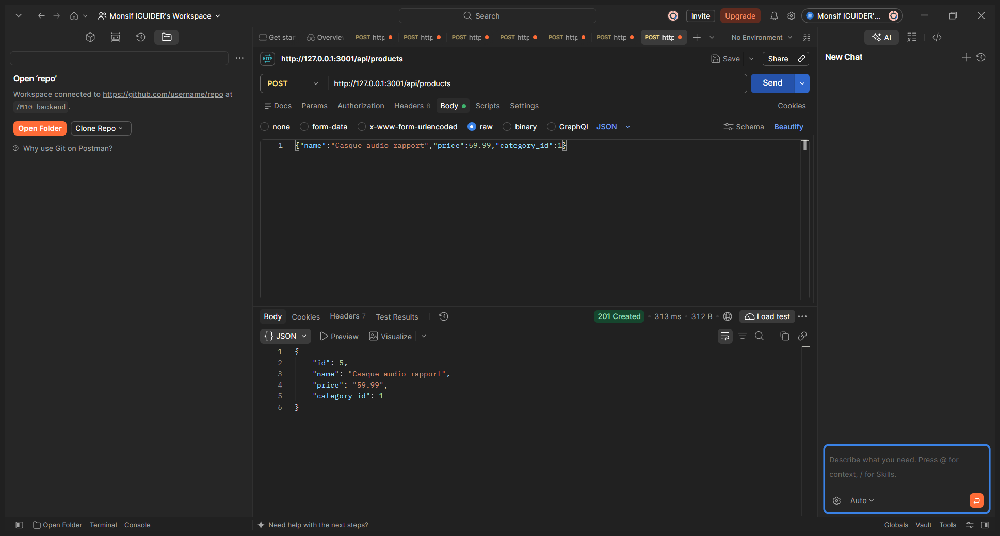
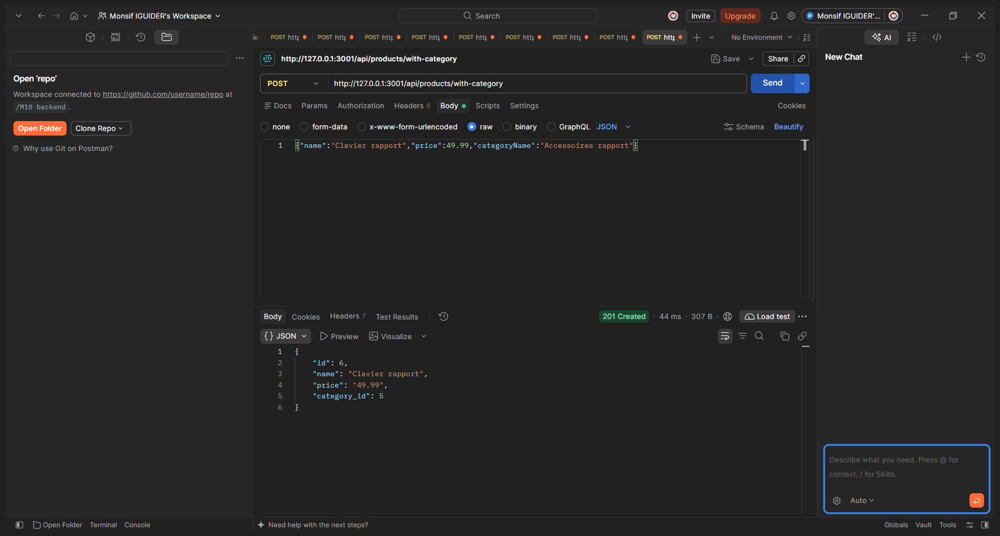
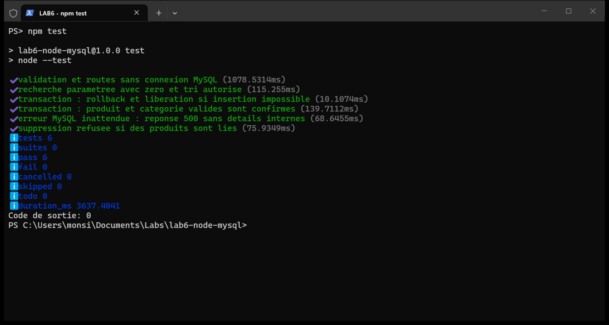

# Rapport de réalisation — LAB6 Node.js et MySQL

**Nom et prénom :** à compléter

**Date :** à compléter

**Enseignant :** à compléter

## Objectif

Construire une API REST de gestion de produits et de catégories, persistée dans MySQL, en utilisant Express, `mysql2`, `async/await` et une architecture en couches.

## Conception

La base `lab_product` contient `categories` et `products`. Un produit référence éventuellement une catégorie par `category_id`. Le pool MySQL réutilise les connexions ; les requêtes utilisent des paramètres pour les données. Le tri est limité à une liste de colonnes autorisées.

Les routes orientent les requêtes HTTP vers les contrôleurs. Les services appliquent les règles métier ; les repositories effectuent les opérations SQL. Les middlewares valident les entrées et produisent des réponses d'erreur cohérentes.

La création avec catégorie utilise une transaction : validation atomique par `COMMIT`, ou annulation par `ROLLBACK` en cas d'erreur, puis libération de la connexion. L'API refuse la suppression d'une catégorie liée (`409`). Le schéma conserve `ON DELETE SET NULL` conformément au sujet ; cette règle de suppression API ne s'applique pas à une suppression SQL directe.

## Réalisation

1. Installation des outils et création de la base et des tables.
2. Configuration locale de la connexion dans `.env`, exclu du dépôt.
3. Implémentation des opérations CRUD, de la recherche et de la pagination.
4. Implémentation de la transaction et de la validation des données.
5. Exécution de scénarios Postman et publication du code sur GitHub.

Lors de la préparation du projet, six tests automatisés avec accès MySQL simulés ont réussi. Une démonstration ultérieure a utilisé MySQL local : une création de produit et une création transactionnelle ont renvoyé `201` dans Postman.

## Résultats à compléter

| Vérification | Résultat observé / capture |
|---|---|
| Tables et données dans MySQL Workbench | À compléter |
| Démarrage local de l'API | À compléter |
| Liste et création de produits (`200`, `201`) | `200` observé en terminal ; création `201` dans Postman |
| Recherche et pagination (`200`) | À compléter |
| Données invalides (`400`) | À compléter |
| Catégorie liée (`409`) et suppression (`204`) | À compléter |
| Création transactionnelle (`201`) | `201` observé dans Postman |
| Page du dépôt GitHub et README | À compléter |

**Lien GitHub :** https://github.com/IguidMnsf/lab6-node-mysql

**Difficultés rencontrées et solutions :** à compléter.

## Captures des exécutions

**Création d'un produit dans Postman — HTTP 201 :**

**Création transactionnelle d'un produit et de sa catégorie — HTTP 201 :**

**Tests automatisés avec base simulée — `npm test` :**

## Conclusion

Ce travail met en pratique les échanges HTTP, la persistance relationnelle, la séparation des responsabilités et les transactions. Les tests automatisés simulant la base ne remplacent pas les vérifications réelles dans MySQL et Postman.
